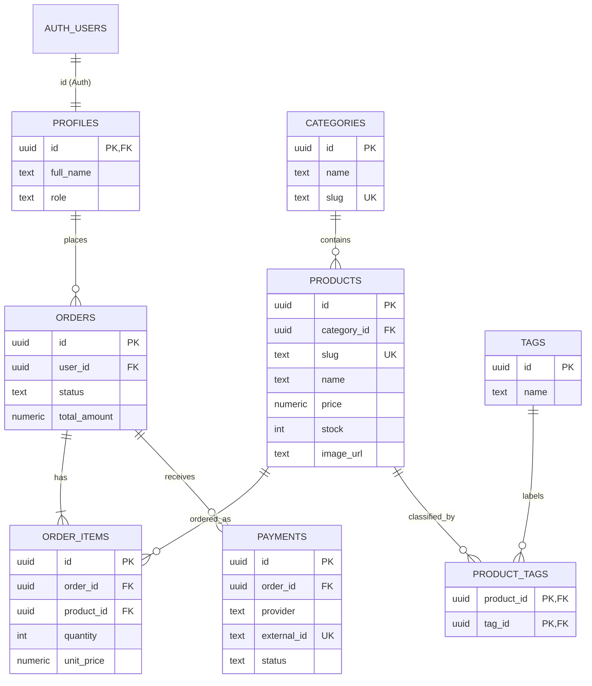

# GREENROOM ERD (8 tables)

The system includes 1:N, N:M, and auth relationships. Paste the Mermaid graph into Mermaid Live Editor if you need an exported SVG/PDF for the Defense-1 slides.

**Authorization**: visitor = anonymous read for active products/categories/tags; user = Auth + own profile/orders/payment read, backend RPC creates orders; admin = database-controlled role and RLS policies for CRUD. Never check `user_metadata` for admin roles. The checkout webhook is the sole normal source of a paid payment event.
